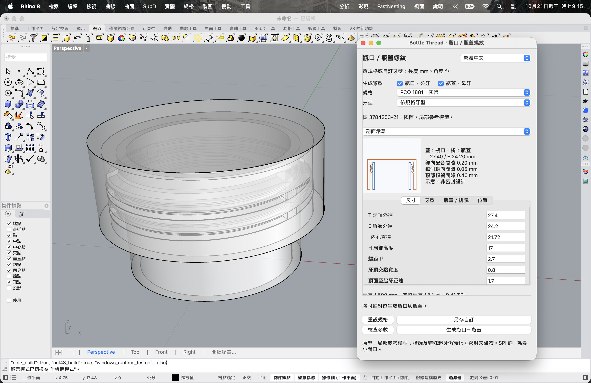
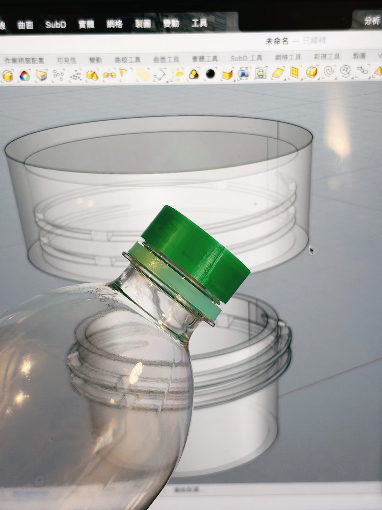
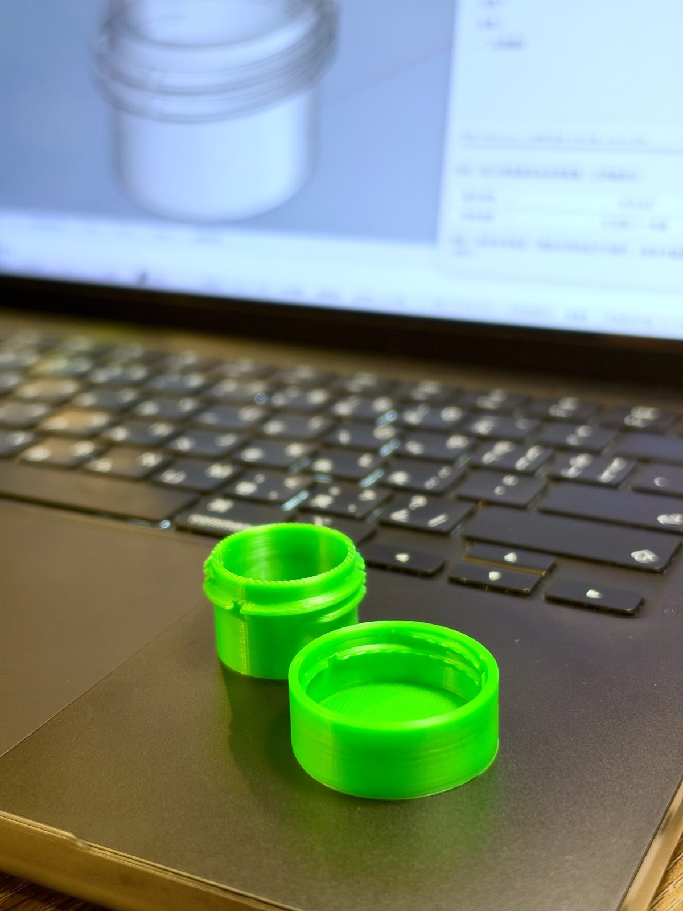

# BottleThread 1.0 for Rhino 8

Rhino 8 瓶口與瓶蓋螺紋建模外掛。提供規格選擇、L／M style 牙型、自訂參數、同軸組裝生成與剖面示意。

**下載：[最新 Release](https://github.com/ZionW/BottleThread/releases/latest) · [所有版本](https://github.com/ZionW/BottleThread/releases)**

> 第一個正式版本 v1.0.0。Mac 已完成安裝與幾何測試；Windows 使用者已確認啟動成功，完整幾何回歸尚未在 Windows 實測。尺寸與配合結果不代表完整 ISBT 瓶蓋認證，也未完成密封、耐壓或完整旋入路徑驗證。



PCO 1881 瓶口與瓶蓋同軸對位示例；半透明顯示方便觀察內外牙及排氣缺口，右側面板提供組合剖面與尺寸調整。

## 實物對照與列印樣件

| 瓶蓋 3D 列印件| 瓶口／瓶蓋 3D 列印件 |
| --- | --- |
|  |  |

照片展示模型與實物對照，以及列印後的瓶口與瓶蓋內外牙細節。

## 安裝

- Rhino **8.35 或更新版本**，macOS／Windows。
- 使用 Rhino 內建 Python 3，不需另裝系統 Python。
- 單一 `*-rh8_35-any.yak` 包含 AnyCPU 的 `net7.0` 與 `net48` 載入器。

1. 至 [Releases](https://github.com/ZionW/BottleThread/releases) 下載 `.yak`。
2. 將 `.yak` 拖入 Rhino 視窗，依提示安裝。
3. **重新啟動 Rhino。**
4. 輸入 **`BottleThread`** 開啟面板。

初次執行如需初始化 Python 3，請讓 Rhino 完成初始化。目前只提供 GitHub Release 的本地 Yak，尚未發布至公開 Yak 套件伺服器。

## 首次啟動自動載入

外掛先透過 RhinoCommon 明確載入內建 `RhinoCodePlugin`，再執行 `_-ScriptEditor _Run` 載入 Python 3 與面板。直接執行 `BottleThread` 即可，無需事先手動開啟 ScriptEditor。

更新後請**完全關閉並重新啟動 Rhino**。首次 Python 初始化可能需要等待；若初始化本身失敗，請提供 `RhinoCodeLogs` 的錯誤紀錄。
Windows 使用者已確認修正後可直接啟動。兩組組件已編譯，七項模擬主機載入器測試通過。
參考：[McNeel 腳本服務載入順序](https://github.com/mcneel/compute.rhino3d/blob/8.x/src/compute.geometry/Startup.cs)、[Rhino 語言初始化說明](https://developer.rhino3d.com/guides/scripting/advanced-langinit/)。

## 使用

1. 勾選「瓶口 · 公牙」、「瓶蓋 · 母牙」或兩者。
2. 選擇預設規格，或切換 L／M style 並調整參數。
3. 在「尺寸」「牙型」「瓶蓋／排氣」「位置」頁籤設定尺寸與配合間隙。
4. 查看剖面、牙型放大或排氣缺口俯視，再按「檢查參數」與「生成」。

雙選會以**相同中心軸、組裝高度與對應螺紋相位**生成兩件獨立實體。組合剖面以藍色顯示瓶口、橘色顯示瓶蓋，說明文字位於圖右側。

- 語系選單位於標題右方：繁體中文、English、日本語、한국어。
- 長度為 mm、角度為 °，生成時會換算為 Rhino 文件單位。
- 模型放在 `BottleThread_UI` 圖層，附參數中繼資料；一次生成可使用 Undo 撤銷。
- 「另存自訂」及語言設定寫入使用者 `LocalApplicationData/BottleThread`，與安裝目錄分開，避免更新覆蓋。
- 原文件關閉時面板會關閉；再次執行指令會綁定目前文件。

## 規格與牙型

| 類別 | 預設 |
| --- | --- |
| 飲料瓶口 | PCO 1881、PCO 1810 |
| 化妝品／包裝瓶口 | 18/410、20/410、22/410、24/410、28/410 |
| 包裝瓶口 | 20/400、24/400、28/400、33/400、38/400 |
| 其他參考圖 | Alcoa 1788、PCO 1816、PCO 1820 |
| 自訂模板 | L style 30°／30°、M style 45°／10°，角度及圓角可調 |

共 17 項預設（含兩個自訂模板）。地區標籤依歷史參考圖分類，不表示當地現行市場占有率，也不是 JIS／KS 等國家標準認證。SPI 的 I 尺寸在參考圖中為最小開口，請依實際設計確認。

PCO 1881 瓶蓋使用**獨立內凸牙**：預設牙高 0.90 mm、牙頂寬 0.50 mm、漸入與收頭各 30°、圓角 0.10 mm。這是可調的參考牙型，並非完整商用瓶蓋尺寸。其他規格保留原先的反向配合生成方式。

PCO 瓶口及瓶蓋內牙的排氣缺口可分別勾選，四處缺口共用寬度與角位參數。瓶蓋切削限制在內牙範圍，保留外壁及蓋頂；缺口端部目前使用矩形近似。

## 驗證狀態

Mac 幾何與安裝測試於 Rhino **8.35.26251.13002 / macOS** 完成；正式版沿用已確認可用的生成程式：

- Yak 安裝、載入 `.rhp`、`BottleThread` 指令啟動及關閉重開。
- 四語切換與使用者設定儲存。
- 從安裝後的資源生成 PCO 1881 對位瓶口／瓶蓋：兩件皆為有效封閉實體，瓶蓋有四處排氣缺口。
- 先前幾何測試：PCO 1881 組裝位置干涉體積為 0、內凸牙高度實測 0.900 mm；PCO 1881／1810／24/410／28/410 瓶口內孔無殘料。

精簡安裝驗證紀錄：[yak/validation.json](yak/validation.json)。Windows 使用者已確認可直接啟動，**完整幾何回歸尚未在 Windows 實測**。無干涉只代表已測組裝位置，不代表完整旋入過程、密封或耐壓通過。

## 原始碼與建置

| 檔案 | 用途 |
| --- | --- |
| `bottle_thread_engine.py` | RhinoCommon BRep 螺紋、瓶口、瓶蓋與排氣缺口 |
| `bottle_thread_panel.py` | Eto 面板、參數與文件生命週期 |
| `bottle_thread_preview.py` | 剖面與缺口示意 |
| `bottle_thread_catalog.json` | 預設參數 |
| `bottle_thread_i18n.json` | 四語介面文字 |
| `yak/src/` | C# AnyCPU 外掛及 `BottleThread` 指令 |
| `yak/build_package.py` | 建置雙目標組件並執行 Yak 封裝 |

需要已安裝的 Rhino 8.35+、可建置 net7.0／net48 的 .NET SDK，以及 Python 3。於 `yak` 資料夾執行：

```sh
dotnet restore src/BottleThread.csproj
python3 build_package.py
```

Windows 可使用 `py -3 build_package.py`。建置使用固定版本的 RhinoCommon NuGet SDK；`BOTTLETHREAD_YAK` 環境變數可指定 Yak 路徑。輸出位於 `yak/dist/`。建置流程目前以 Mac 驗證。

## 參考來源與限制

- [ISBT Threadspecs](https://www.isbt.com/resources/isbt-threadspecs): 瓶口參考圖；本儲存庫不重新散布原始 PDF。
- [Bericap 內牙設計說明 WO2017009064A1](https://patents.google.com/patent/WO2017009064A1/en): 內凸牙結構參考，並非本外掛已取得瓶蓋認證的依據。
- [McNeel 多目標 Yak 套件說明](https://developer.rhino3d.com/en/guides/yak/creating-a-multi-targeted-rhino-plugin-package/)。

尚未包含完整防盜環、密封圈／內塞、所有商用瓶蓋的牙型與缺口細節。製造或使用於承壓容器前，需以受控工程圖及實物量測確認。

---

## English quick start

BottleThread generates reference bottle-neck and cap threads in Rhino 8.35+ on macOS and Windows. Download the `.yak` from Releases, drag it into Rhino, **restart Rhino**, then run `BottleThread`.

Select neck, cap, or both. Paired outputs share an assembled axis and thread phase. The panel supports 17 presets/templates, custom L/M profiles, independent cap vent slots, section previews, and Traditional Chinese / English / Japanese / Korean.

Version 1.0 explicitly loads Rhino’s built-in scripting service before running the panel. Normal use requires only BottleThread, without opening ScriptEditor first. Windows launch is user-confirmed; full Windows geometry regression is pending. Both assemblies build and seven simulated-host dispatch tests pass. Installation and geometry were tested on Mac. PCO 1881 cap dimensions are adjustable reference values, not a certified closure specification. Sealing, pressure resistance and the full screw-on motion remain unverified.

載入器回歸測試（.NET 10 SDK，模擬主機）：`dotnet run --project yak/tests/LauncherTests.csproj`。
